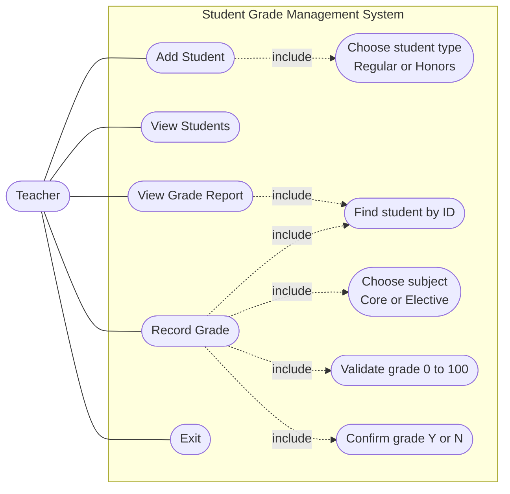

# Student Grade Management System

## About the App

The Student Grade Management System is a Java console application that helps a teacher keep track of
students and their grades. The teacher uses a simple numbered menu to register students, record grades
and see how each student is performing. Everything is done by typing in the console.

The app is also a practice project for Object-Oriented Programming in Java: it uses inheritance,
abstract classes, an interface, polymorphism, encapsulation and composition.

## What the App Does

| Feature | What it does |
|---|---|
| Add Student | Registers a new student with name, age, email and phone. The app creates a unique ID automatically (STU001, STU002, ...) and sets the status to Active. |
| View Students | Shows all students with their ID, name, type, average grade and status (Passing or Failing), plus the total number of students and the class average. |
| Record Grade | Saves a grade from 0 to 100 for a student in a chosen subject. The teacher confirms the grade before it is saved. The app creates a unique grade ID (GRD001, GRD002, ...) and the date. |
| View Grade Report | Shows one student's grade history (newest first), the core, elective and overall averages, and whether the student is passing. |
| Menu | A simple menu that keeps coming back after each action until the teacher chooses Exit. |

### Student types

| Type | Passing grade | Extra |
|---|---|---|
| Regular Student | 50% | Standard grading |
| Honors Student | 60% | Honors eligible when the average is 85% or higher |

### Subject types

| Type | Subjects |
|---|---|
| Core (mandatory) | Mathematics, English, Science |
| Elective (optional) | Music, Art, Physical Education |

## Use Case Diagram

The teacher is the only user (actor). The box shows everything the system lets the teacher do.

### Use case descriptions

| Use case | Actor | What happens |
|---|---|---|
| Add Student | Teacher | The teacher enters the student's details and picks a type. The system creates the student, generates an ID and shows a confirmation. |
| View Students | Teacher | The system lists all students with averages and statuses, the total number of students and the class average. |
| Record Grade | Teacher | The teacher enters a student ID, picks a subject, enters a grade and confirms. The system saves the grade with a new ID and date. |
| View Grade Report | Teacher | The teacher enters a student ID. The system shows the grade history, the averages and the passing status, or a message if there are no grades yet. |
| Exit | Teacher | The system shows a goodbye message and the program ends. |